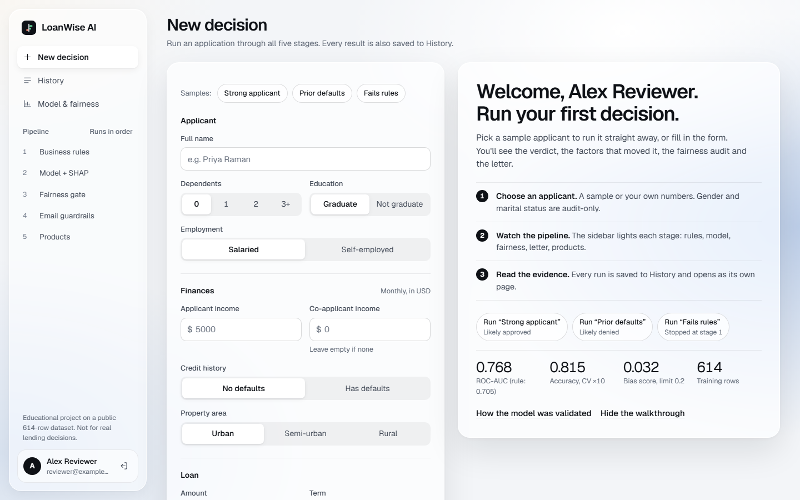
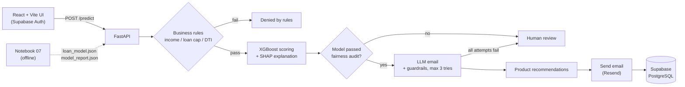

# LoanWise AI

**An end-to-end, AI-assisted loan decisioning platform:** a React frontend, a FastAPI backend serving a cross-validated XGBoost model with per-applicant SHAP explanations, a fairness audit, and LLM-generated decision emails with guardrails.


[](https://github.com/SabeehAnsari/loanwise-ai/actions/workflows/ci.yml)

> **Educational project.** LoanWise AI is built on a small public dataset to demonstrate full stack and applied-ML engineering. It is **not** intended for real lending decisions. See [Limitations](#limitations).

## Screenshots

<p align="center">
  
  
</p>

The app has a public landing page, sign-in, and a signed-in workspace with three pages: **New decision** (form plus the result, with the sidebar pipeline lighting the stage that decided the outcome), **History** (every saved run, filterable, each opening as its own decision page) and **Model & fairness** (the model card, baselines, inputs, business rules and the fairness audit). The visual system ("Glass & Light") is documented in [`DESIGN.md`](DESIGN.md).

## Overview

A user signs in, submits a loan application, and the backend runs it through a multi-stage pipeline: hard business rules, ML scoring with an explanation, a fairness gate, an LLM-written decision email validated by guardrails, and product recommendations. The result, fairness metrics and email are shown in the UI, emailed to the signed-in user's address, and stored in PostgreSQL.

## Features

- **Full stack web app**: responsive React 19 + Vite + Tailwind CSS UI with email/password authentication (Supabase Auth, JWT-based sessions).
- **Explainable interface**: a sidebar pipeline shows which stage passed, failed or was skipped and lights the one that decided the outcome; SHAP factors are drawn as a diverging bar chart; the fairness audit shows each gap with its 95% CI against the limit; rule rejections show which business rule failed. One-click sample applicants (with a first-run walkthrough), a live repayment-to-income check, a decision history with per-decision pages, and a public landing page and model card built from `GET /model`. Design records live in [`PRODUCT.md`](PRODUCT.md) and [`DESIGN.md`](DESIGN.md).
- **Typed REST API**: FastAPI with range-checked Pydantic validation and auto-generated OpenAPI docs at `/docs`.
- **Secured API**: protected endpoints verify the user's Supabase JWT server-side, CORS is restricted to configured origins, `/predict` is rate-limited per IP, and LLM output is HTML-escaped before it is emailed.
- **Rigorous model evaluation**: seven candidates, including majority-class and credit-history-rule baselines, compared with repeated stratified cross-validation. Preprocessing is fitted inside each fold to avoid leakage.
- **Protected attributes excluded**: gender and marital status are *not* model inputs. Removing them cost no accuracy, and a test proves that flipping them cannot change a score.
- **Per-applicant explanations**: every decision shows its top factors, computed with TreeSHAP (XGBoost's built-in `pred_contribs`).
- **Fairness audit**: approval-rate and false-negative-rate gaps by gender and marital status, measured on out-of-fold predictions with bootstrap confidence intervals. If the deployed model fails the audit, automated decisions are switched off.
- **Business-rule layer** that runs *before* the model, so clearly ineligible applications never reach it.
- **LLM email generation with guardrails**: GPT-generated decision emails are validated (no invented rates or payment amounts, the correct decision stated without contradiction, length, required signature) and regenerated up to 3 times before escalating to human review.
- **Product recommendations**: eligibility is decided by deterministic rules; the LLM only writes the recommendation text.
- **Persistence**: every application, including rule rejections and human-review cases, is stored in Supabase (PostgreSQL) under row-level security.
- **Tested**: 73 pytest tests (rules, guardrails, feature parity between training and serving, scoring invariants, persistence, end-to-end API with all external services stubbed) and 78 Vitest + React Testing Library UI tests (form validation, pipeline stages, routing and auth guards, running a decision, history filters, decision pages) run in GitHub Actions together with frontend lint and build.

## Architecture



## Tech stack

| Layer | Technologies |
|---|---|
| Frontend | React 19, Vite, Tailwind CSS 4, Supabase JS client |
| Backend | Python, FastAPI, Pydantic, Uvicorn, httpx |
| ML / data | XGBoost (with TreeSHAP), scikit-learn, pandas, NumPy, Jupyter |
| AI | OpenAI API (`gpt-4o-mini`) with rule-based guardrails |
| Data & auth | Supabase (PostgreSQL + Auth) |
| Email | Resend |
| Quality | pytest, Vitest, React Testing Library, ESLint, GitHub Actions |

## Model evaluation

Data: the public *Loan Prediction* dataset (614 labelled applications, 68.7% approved). Protocol, from [`notebooks/07_model_evaluation.ipynb`](notebooks/07_model_evaluation.ipynb): repeated stratified 5-fold cross-validation (10 repeats, 50 fits per model, the same splits for every model), with imputation and feature engineering fitted inside each training fold.

| Model | Accuracy | Balanced acc. | F1 | ROC-AUC |
|---|---|---|---|---|
| Majority class | 0.687 ± 0.004 | 0.500 | 0.815 | 0.500 |
| Credit-history rule (approve iff good credit) | 0.809 ± 0.027 | 0.705 | 0.877 | 0.705 |
| Logistic regression | 0.808 ± 0.027 | 0.704 | 0.875 | 0.704 |
| Random forest | 0.817 ± 0.026 | 0.729 | 0.879 | 0.765 |
| XGBoost, original config (notebook 03) | 0.760 ± 0.034 | 0.710 | 0.828 | 0.762 |
| XGBoost, shallow | 0.814 ± 0.026 | 0.722 | 0.878 | 0.768 |
| **XGBoost, shallow, no gender/marital (deployed)** | **0.815 ± 0.028** | **0.722** | **0.878** | **0.768 ± 0.047** |

What this shows:

- **The original model underperformed a one-line rule.** It lost to the credit-history rule in 47 of 50 folds, mainly because `scale_pos_weight` down-weighted the approved class. Its earlier single-split test accuracy (0.790 on 62 rows) was flattering noise.
- **No model beats the credit-history rule on accuracy by a meaningful margin.** Credit history dominates this dataset: its mean |SHAP| is 0.84, against 0.17 for the next feature.
- **The model's value is in ranking.** ROC-AUC is 0.768 against 0.705, better in 49 of 50 folds. The model separates risk *within* the good-credit group, which a binary rule cannot do.
- **Removing gender and marital status costs nothing**, so the deployed model does not use them.

Choosing the best of seven candidates on the same CV makes the final estimate slightly optimistic, and with 614 rows every figure carries wide uncertainty.

<p align="center"></p>

## Fairness audit

The audit runs offline, on **out-of-fold** predictions: each applicant is scored by a model that never saw them. Gaps are averaged over 10 repetitions, and the confidence intervals come from 1,000 bootstrap resamples. The results are stored in `src/model_report.json` and served at `GET /model`.

```
bias_score = 0.40 * gender_approval_gap + 0.40 * gender_FNR_gap + 0.20 * marital_approval_gap
```

| Metric | Original model (with gender/marital) | Deployed model | 95% CI (deployed) |
|---|---|---|---|
| Gender approval-rate gap | 0.090 | 0.039 | 0.002 – 0.128 |
| Marital-status approval-rate gap | 0.128 | 0.012 | 0.001 – 0.083 |
| False-negative-rate gap (by gender) | 0.064 | 0.035 | 0.002 – 0.111 |
| **Bias score** (threshold 0.20) | 0.087 | **0.032** | 0.010 – 0.099 |

Every point estimate fell after the protected attributes were removed. The intervals overlap, though, because there are only 112 female applicants, so the improvement is suggestive rather than proven. The attributes can still have an indirect effect through correlated features such as co-applicant income, which is why outcomes are still audited by group.

**How the gate works:** the audit describes the *deployed model*, so it is the same for every applicant. If a retrained model's bias score exceeds 0.20, the API routes every application to human review instead of deciding automatically. Per-applicant transparency comes from the SHAP explanation attached to each decision.

## Project structure

```
.
├── src/                       # FastAPI backend
│   ├── main.py                # API routes and pipeline orchestration
│   ├── features.py            # Feature engineering shared by training, serving and tests
│   ├── scoring.py             # Model loading, scoring and TreeSHAP explanations
│   ├── rules.py               # Hard business rules (run before the model)
│   ├── bias_agent.py          # Fairness gate built from the offline audit
│   ├── email_agent.py         # LLM email generation + guardrail validation
│   ├── marketing_agent.py     # Rule-based eligibility + LLM recommendation text
│   ├── email_sender.py        # Resend integration
│   ├── database.py            # Supabase REST persistence
│   ├── auth.py                # Supabase JWT verification (FastAPI dependency)
│   ├── loan_model.json        # Deployed XGBoost model (portable JSON, no pickle)
│   └── model_report.json      # CV metrics + fairness audit for the deployed model
├── tests/                     # pytest suite (no network access needed)
├── frontend/                  # React + Vite + Tailwind UI (React Router)
│   ├── src/index.css          # Design tokens and component styles
│   ├── src/pages/             # Landing, AuthPage, NewDecision, History,
│   │                          # DecisionDetail, ModelPage, NotFound
│   ├── src/components/        # AppShell (sidebar + pipeline), LoanForm, ResultView,
│   │                          # DecisionCard, BiasReport, EmailPreview, Icons
│   ├── src/lib/               # API client, auth context, record mapping, samples
│   ├── src/pipeline.js        # Maps an API response to the five pipeline stages
│   └── src/useModelReport.js  # Public model card from /model (with a published fallback)
├── PRODUCT.md, DESIGN.md      # Product context and the UI design system
├── notebooks/                 # 01–02 EDA/preprocessing, 03 original training (superseded),
│                              # 04–06 agent development, 07 evaluation + final model
├── data/                      # Raw and processed datasets
├── docs/                      # Database schema and figures
├── .github/workflows/ci.yml   # Tests, lint and build on every push
├── requirements.txt           # API runtime
└── requirements-dev.txt       # + pytest and notebook tooling
```

## Getting started

### Prerequisites

- Python 3.11+
- Node.js 20.19+ (required by Vite 8)
- A [Supabase](https://supabase.com) project, an [OpenAI](https://platform.openai.com) API key, and a [Resend](https://resend.com) API key

### 1. Clone and configure

```bash
git clone https://github.com/SabeehAnsari/loanwise-ai.git
cd loanwise-ai
cp .env.example .env                       # then fill in your keys
cp frontend/.env.example frontend/.env.local
```

### 2. Set up the database

Run [`docs/supabase_schema.sql`](docs/supabase_schema.sql) in the Supabase SQL editor to create the `applications` table and Row Level Security policies.

Already have the table from an earlier version? Run the two `alter table … add column if not exists` lines at the end of that file, so each application also stores its SHAP factors and rejection message for the decision pages. Until you do, applications still save, just without those two fields.

### 3. Run the backend

```bash
python -m venv .venv
source .venv/bin/activate                  # Windows: .venv\Scripts\activate
pip install -r requirements-dev.txt         # or requirements.txt for the API only

cd src
python -m uvicorn main:app --reload --port 8000
```

Interactive API docs: http://127.0.0.1:8000/docs

### 4. Run the frontend

```bash
cd frontend
npm install
npm run dev
```

Open the URL Vite prints (default http://localhost:5173). The landing page is public; **Try the demo** creates an account and runs a sample applicant. The app uses client-side routes (`/app/new`, `/app/history`, `/app/decisions/:id`, `/app/model`), so a static host must rewrite unknown paths to `index.html`.

### 5. Run the tests

```bash
python -m pytest   # backend, from the repository root; no API keys or network needed

cd frontend
npm test           # UI (Vitest + React Testing Library, jsdom); `npm run test:watch` while editing
```

### Retraining the model

Run `notebooks/07_model_evaluation.ipynb` from start to finish. It rewrites `src/loan_model.json` and `src/model_report.json`, and the API serves the new model on its next start.

### Environment variables

| Variable | Used by | Purpose |
|---|---|---|
| `OPENAI_API_KEY` | backend | Email and recommendation generation |
| `SUPABASE_URL` | backend | Supabase project URL |
| `SUPABASE_ANON_KEY` | backend | Supabase public (anon) key |
| `RESEND_API_KEY` | backend | Sending decision emails |
| `ALLOWED_ORIGINS` | backend | Comma-separated frontend origin(s) allowed by CORS |
| `VITE_SUPABASE_URL` | frontend | Supabase project URL |
| `VITE_SUPABASE_ANON_KEY` | frontend | Supabase public (anon) key |
| `VITE_API_URL` | frontend | Base URL of the FastAPI backend |

## API reference

| Method | Endpoint | Description |
|---|---|---|
| `GET` | `/` | API info |
| `GET` | `/health` | Health check |
| `GET` | `/model` | Model card: features, CV metrics and fairness audit |
| `POST` | `/predict` | Run the full decision pipeline (auth required) |
| `GET` | `/applications/{user_id}` | List your own past applications (auth required) |

Protected endpoints expect a Supabase access token: `Authorization: Bearer <token>`. The backend verifies it with Supabase Auth and takes the user identity from the token, never from the request body.

**Example: `POST /predict`**

```json
{
  "name": "Jane Doe",
  "gender": 0,
  "married": 1,
  "dependents": 1,
  "education": 1,
  "self_employed": 0,
  "applicant_income": 5000,
  "coapplicant_income": 1500,
  "loan_amount": 120,
  "loan_amount_term": 360,
  "credit_history": 1.0,
  "property_area": 2
}
```

The decision email goes to the authenticated user's own address. `loan_amount` is in thousands and `loan_amount_term` in months. The response contains the `decision`, model `probability`, an `explanation` (the top SHAP factors for this applicant), the `bias_report` (the model-level fairness audit), the generated `email`, and `marketing` recommendations. `gender` and `married` are collected for the audit only and do not affect the score. When a case is escalated the `status` is `HUMAN_REVIEW`; when it fails a business rule it is `REJECTED_BY_RULES`.

### Business rules (evaluated before the model)

| Rule | Condition for rejection |
|---|---|
| Minimum income | Combined monthly income < $500 |
| Loan cap | Loan amount > $10,000,000 |
| Positive amount | Loan amount ≤ 0 |
| Debt-to-income | Estimated monthly payment / income > 60% |

## Design decisions

- **Deterministic rules before and around the LLM.** Eligibility and approval are never decided by the language model; it only writes text, and its output is validated before use.
- **Fail safe, not silent.** Any case that trips the fairness gate or fails email guardrails is escalated to human review instead of being auto-decided.
- **One feature pipeline.** `src/features.py` is imported by the training notebook, the API and the tests, and a test checks that the training and serving paths produce identical features.
- **Baselines first.** A model is only worth deploying if it beats simple rules. Here it matches the credit-history rule on accuracy and beats it on ranking, and the README reports that honestly.
- **Portable model artefact.** The model is saved as XGBoost JSON rather than a pickle, so loading it cannot execute arbitrary code.

## Limitations

This is a learning project, and these limitations are deliberate to state:

- **Not for real lending.** The model is trained on ~600 public records from an unknown population and has never been validated on real applicants.
- **Fairness through unawareness is not enough.** Gender and marital status are excluded as inputs, but correlated features can still carry their effect. The audit measures outcomes, but with 112 female applicants its confidence intervals are wide.
- **Model-level audit.** The fairness gate describes the deployed model as a whole. Individual transparency comes from SHAP explanations, which describe the model's reasoning, not causal effects.
- **Simplified rules.** The debt-to-income rule ignores interest, and the guardrails are regex-based, so they can miss unusual wording.
- **Email sending** uses Resend's shared test sender, which only delivers to the account owner's address until a domain is verified.

## Roadmap

- [x] Server-side verification of Supabase JWTs on protected endpoints
- [x] Rate limiting on `/predict` (10 requests/minute per IP), since it calls a paid LLM API
- [x] Automated tests (pytest) and GitHub Actions CI
- [x] Persist human-review and rule-rejected cases
- [x] Per-applicant explanations (TreeSHAP) and a stronger evaluation protocol (repeated CV with baselines)
- [x] Remove protected attributes from the model and audit on out-of-fold predictions
- [x] UI redesign: landing page, sign-in, app shell with sidebar pipeline, rule-rejection and human-review states, sample applicants
- [x] Application history page with per-decision pages
- [x] Vitest tests for the UI
- [ ] Dockerfile and docker-compose for one-command setup
- [ ] Deployment (frontend + API) with a live demo link

## Data

Uses the *Loan Prediction* dataset (Analytics Vidhya / Kaggle). Credit goes to the original dataset authors; check the dataset's terms before redistributing.

## Author

**Sabeeh Ansari**: Computer Science undergraduate, Beijing Institute of Technology
[GitHub](https://github.com/SabeehAnsari) · [Email](mailto:Sabeehansari@outlook.com)
