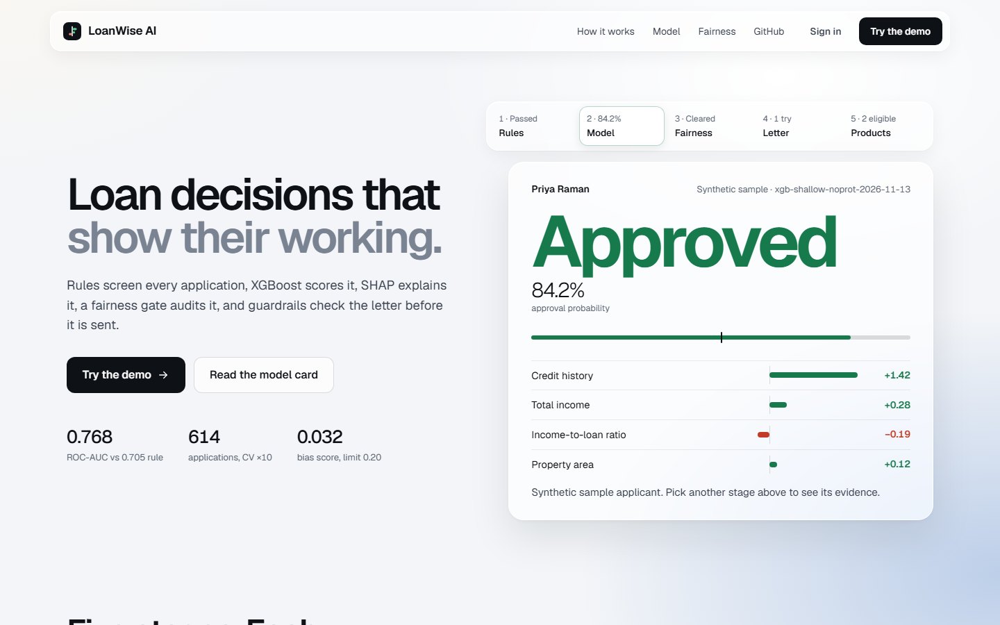
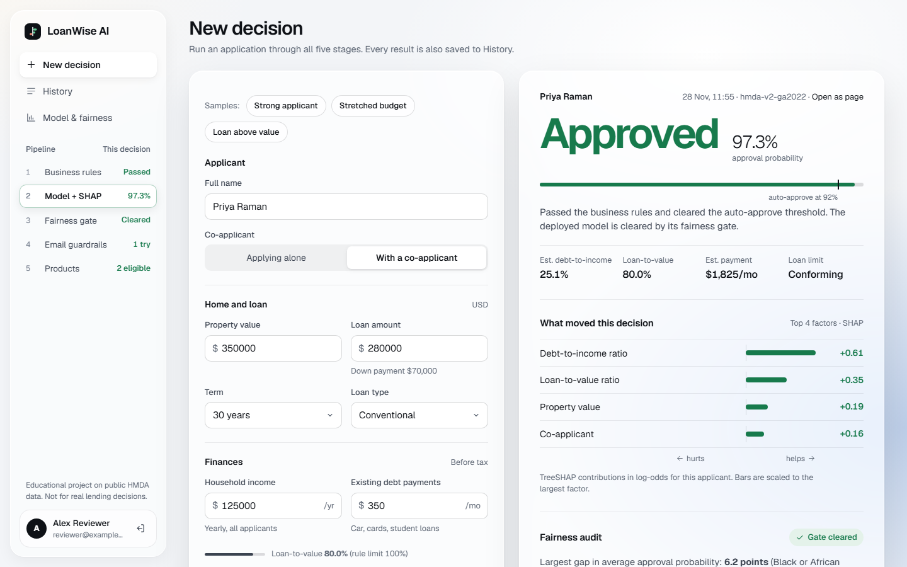
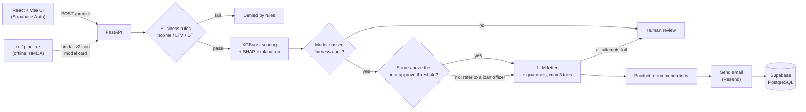
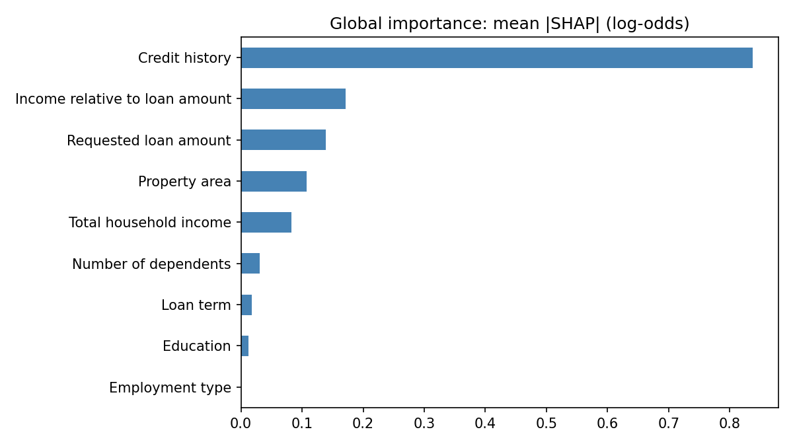

# LoanWise AI

**An end-to-end, AI-assisted loan decisioning platform:** a React frontend, a FastAPI backend serving a cross-validated XGBoost model with per-applicant SHAP explanations, a fairness audit, and LLM-generated decision emails with guardrails.


[](https://github.com/SabeehAnsari/loanwise-ai/actions/workflows/ci.yml)

> **Educational project.** LoanWise AI is built on a small public dataset to demonstrate full stack and applied-ML engineering. It is **not** intended for real lending decisions. See [Limitations](#limitations).

## Screenshots

<p align="center">
  
  
</p>

The app has a public landing page, sign-in, and a signed-in workspace with three pages: **New decision** (form plus the result, with the sidebar pipeline lighting the stage that decided the outcome), **History** (every saved run, filterable, each opening as its own decision page) and **Model & fairness** (the model card, baselines, inputs, business rules and the fairness audit). The visual system ("Glass & Light") is documented in [`DESIGN.md`](DESIGN.md).

## Overview

A user signs in, submits a mortgage application, and the backend runs it through a multi-stage pipeline: hard business rules, scoring by a model trained on 151,421 real US lending decisions (HMDA) with a per-applicant explanation, a fairness gate, an auto-approve-or-refer decision (the model never denies), an LLM-written letter validated by guardrails, and product recommendations. The result, fairness metrics and email are shown in the UI, emailed to the signed-in user's address, and stored in PostgreSQL.

## Features

- **Full stack web app**: responsive React 19 + Vite + Tailwind CSS UI with email/password authentication with password reset (Supabase Auth, JWT-based sessions).
- **Explainable interface**: a sidebar pipeline shows which stage passed, failed or was skipped and lights the one that decided the outcome; SHAP factors are drawn as a diverging bar chart; the fairness audit shows each gap with its 95% CI against the limit; rule rejections show which business rule failed. One-click sample applicants (with a first-run walkthrough), live loan-to-value and debt-to-income estimates, a decision history with per-decision pages, and a public landing page and model card built from `GET /model`. Design records live in [`PRODUCT.md`](PRODUCT.md) and [`DESIGN.md`](DESIGN.md).
- **Typed REST API**: FastAPI with range-checked Pydantic validation and auto-generated OpenAPI docs at `/docs`.
- **Secured API**: protected endpoints verify the user's Supabase JWT server-side, CORS is restricted to configured origins, `/predict` is rate-limited per IP, and LLM output is HTML-escaped before it is emailed.
- **Rigorous model evaluation**: trained on one year of HMDA decisions and tested once on the next; baselines include a one-line DTI rule and logistic regression; leakage and separation audits; drift across years and transfer to four unseen states (see [ML v2](#ml-v2-850000-real-mortgage-decisions)).
- **Protected attributes excluded**: sex, race, ethnicity and age are collected (optionally) for the audit only and are *not* model inputs; a test proves changing them cannot change a score. Census-tract geography is excluded too, because it acts as a proxy for race.
- **Per-applicant explanations**: every decision shows its top factors, computed with TreeSHAP (XGBoost's built-in `pred_contribs`).
- **Fairness audit**: approval and referral gaps by sex, race, ethnicity and age on held-out data, with bootstrap confidence intervals. If the deployed model's average approval gap exceeds its limit, automated decisions switch off; the larger referral gaps at the operating threshold are disclosed with every decision.
- **Business-rule layer** that runs *before* the model, so clearly ineligible applications never reach it.
- **LLM email generation with guardrails**: GPT-generated decision emails are validated (no invented rates or payment amounts, the correct decision stated without contradiction, length, required signature) and regenerated up to 3 times before escalating to human review.
- **Product recommendations**: eligibility is decided by deterministic rules; the LLM only writes the recommendation text.
- **Persistence**: every application, including rule rejections and human-review cases, is stored in Supabase (PostgreSQL) under row-level security.
- **Tested**: 134 pytest tests (ML pipeline, training/serving parity, rules, guardrails including referral letters, monotonic and protected-attribute scoring invariants, persistence, end-to-end API with all external services stubbed) and 91 Vitest + React Testing Library UI tests (form validation, pipeline stages, routing and auth guards, password reset, running a decision, history filters, decision pages) run in GitHub Actions together with frontend lint and build.

## Architecture



## Tech stack

| Layer | Technologies |
|---|---|
| Frontend | React 19, Vite, Tailwind CSS 4, Supabase JS client |
| Backend | Python, FastAPI, Pydantic, Uvicorn, httpx |
| ML / data | XGBoost (with TreeSHAP), scikit-learn, pandas, NumPy, Jupyter |
| AI | OpenAI API (`gpt-4o-mini`) with rule-based guardrails |
| Data & auth | Supabase (PostgreSQL + Auth) |
| Email | Resend |
| Quality | pytest, Vitest, React Testing Library, ESLint, GitHub Actions |

## ML v2: 850,000 real mortgage decisions

The app serves **v2**. The original model (v1, below) was trained on 614 rows; v2 replaces the data with public [HMDA](https://ffiec.cfpb.gov/data-browser/) records: every Georgia home-purchase decision in 2022 (151,421 applications, used to train) and 2023 (120,170, used once to test). Georgia 2021 and 2023 data from North Carolina, Ohio, Arizona and Washington test drift and generalisation (852,883 applications in all). It's a reproducible, tested pipeline in [`ml/`](ml/). Read the one-page write-up first: **[case study](docs/case-study.md)**. Full auto-generated results: [`reports/ml/REPORT.md`](reports/ml/REPORT.md).

| Model, trained on 2022, tested on 2023 | ROC-AUC | Denial PR-AUC |
|---|---|---|
| Approve if DTI ≤ 43% (one-line rule) | 0.614 | 0.139 |
| Logistic regression | 0.725 | 0.405 |
| **XGBoost, monotonic constraints (chosen)** | **0.789** | **0.537** |

- **Leakage, caught twice.** Post-decision columns (e.g. interest rate, closing costs, denial reasons) push AUC to a fake 1.000, and a missingness audit flags them. A subtler *selection* leak (`preapproval`: all 8,613 requests in the extract were approved) is caught by a separation audit. It had inflated AUC (0.789 → 0.799) and the share of applications safe to automate (0.9% → 12.2%).
- **Automation, not denial.** The model auto-approves or refers to a person. The threshold is chosen on 2022 for a 5% wrong-auto-approval budget; on 2023 it automated 69.2% of applications at 4.9% wrong.
- **Fairness at the threshold.** Financial features explain about two-thirds of the lenders' Black–White approval gap (−6.2 vs −9.8 points). But at the operating threshold, lender-approved Black applicants are 21.7 points more likely to be referred for review. Census-tract features widen this to 30.7 points, so they are excluded; reweighing narrows it to 17.7 points.
- **Robustness.** A model left unretrained since 2021 drifts just past its error budget, while the yearly retrained one stays within it. The Georgia model comes within 0.004–0.020 AUC of models trained in-state in four other states, and the referral gap replicates in all of them (Black–White +12.8 to +24.0 points).

```bash
pip install -r requirements-dev.txt
python -m ml.run          # downloads ~430 MB once (checksummed), then a few minutes
python -m pytest tests/ml_pipeline
```

## Model evaluation (v1, archived)

Data: the public *Loan Prediction* dataset (614 labelled applications, 68.7% approved). Protocol, from [`notebooks/07_model_evaluation.ipynb`](notebooks/07_model_evaluation.ipynb): repeated stratified 5-fold cross-validation (10 repeats, 50 fits per model, the same splits for every model), with imputation and feature engineering fitted inside each training fold.

| Model | Accuracy | Balanced acc. | F1 | ROC-AUC |
|---|---|---|---|---|
| Majority class | 0.687 ± 0.004 | 0.500 | 0.815 | 0.500 |
| Credit-history rule (approve iff good credit) | 0.809 ± 0.027 | 0.705 | 0.877 | 0.705 |
| Logistic regression | 0.808 ± 0.027 | 0.704 | 0.875 | 0.704 |
| Random forest | 0.817 ± 0.026 | 0.729 | 0.879 | 0.765 |
| XGBoost, original config (notebook 03) | 0.760 ± 0.034 | 0.710 | 0.828 | 0.762 |
| XGBoost, shallow | 0.814 ± 0.026 | 0.722 | 0.878 | 0.768 |
| **XGBoost, shallow, no gender/marital (deployed)** | **0.815 ± 0.028** | **0.722** | **0.878** | **0.768 ± 0.047** |

What this shows:

- **The original model underperformed a one-line rule.** It lost to the credit-history rule in 47 of 50 folds, mainly because `scale_pos_weight` down-weighted the approved class. Its earlier single-split test accuracy (0.790 on 62 rows) was flattering noise.
- **No model beats the credit-history rule on accuracy by a meaningful margin.** Credit history dominates this dataset: its mean |SHAP| is 0.84, against 0.17 for the next feature.
- **The model's value is in ranking.** ROC-AUC is 0.768 against 0.705, better in 49 of 50 folds. The model separates risk *within* the good-credit group, which a binary rule cannot do.
- **Removing gender and marital status costs nothing**, so the deployed model does not use them.

Choosing the best of seven candidates on the same CV makes the final estimate slightly optimistic, and with 614 rows every figure carries wide uncertainty.

<p align="center"></p>

## Fairness audit (v1)

The audit runs offline, on **out-of-fold** predictions: each applicant is scored by a model that never saw them. Gaps are averaged over 10 repetitions, and the confidence intervals come from 1,000 bootstrap resamples. The results are stored in `src/model_report.json` and served at `GET /model`.

```
bias_score = 0.40 * gender_approval_gap + 0.40 * gender_FNR_gap + 0.20 * marital_approval_gap
```

| Metric | Original model (with gender/marital) | Deployed model | 95% CI (deployed) |
|---|---|---|---|
| Gender approval-rate gap | 0.090 | 0.039 | 0.002 – 0.128 |
| Marital-status approval-rate gap | 0.128 | 0.012 | 0.001 – 0.083 |
| False-negative-rate gap (by gender) | 0.064 | 0.035 | 0.002 – 0.111 |
| **Bias score** (threshold 0.20) | 0.087 | **0.032** | 0.010 – 0.099 |

Every point estimate fell after the protected attributes were removed. The intervals overlap, though, because there are only 112 female applicants, so the improvement is suggestive rather than proven. The attributes can still have an indirect effect through correlated features such as co-applicant income, which is why outcomes are still audited by group.

**How the gate works:** the audit describes the *deployed model*, so it is the same for every applicant. If a retrained model's bias score exceeds 0.20, the API routes every application to human review instead of deciding automatically. Per-applicant transparency comes from the SHAP explanation attached to each decision.

## Project structure

```
.
├── src/                       # FastAPI backend
│   ├── main.py                # API routes and pipeline orchestration
│   ├── scoring.py             # v2 scoring via ml/serving.py + TreeSHAP explanations
│   ├── rules.py               # Hard business rules (run before the model)
│   ├── bias_agent.py          # Fairness gate built from the offline audit
│   ├── email_agent.py         # LLM email generation + guardrail validation
│   ├── marketing_agent.py     # Rule-based eligibility + LLM recommendation text
│   ├── email_sender.py        # Resend integration
│   ├── database.py            # Supabase REST persistence
│   ├── auth.py                # Supabase JWT verification (FastAPI dependency)
│   └── models/                # Deployed v2 model (XGBoost JSON, no pickle) + model card
├── ml/                        # v2 pipeline on HMDA: download (checksummed), prepare, models,
│                              # evaluate, robustness, serving (form -> features), export
├── reports/v1/                # Archived v1 model, features and report
├── reports/ml/                # Generated results: REPORT.md, results.json, figures, model
├── data/hmda/manifest.json    # Source URLs and SHA-256 of the HMDA extracts (raw files not committed)
├── docs/case-study.md         # One-page write-up of the v2 findings
├── tests/                     # pytest suite (no network access needed)
├── frontend/                  # React + Vite + Tailwind UI (React Router)
│   ├── src/index.css          # Design tokens and component styles
│   ├── src/pages/             # Landing, AuthPage, NewDecision, History,
│   │                          # DecisionDetail, ModelPage, NotFound
│   ├── src/components/        # AppShell (sidebar + pipeline), LoanForm, ResultView,
│   │                          # DecisionCard, BiasReport, EmailPreview, Icons
│   ├── src/lib/               # API client, auth context, record mapping, samples
│   ├── src/pipeline.js        # Maps an API response to the five pipeline stages
│   └── src/useModelReport.js  # Public model card from /model (with a published fallback)
├── PRODUCT.md, DESIGN.md      # Product context and the UI design system
├── notebooks/                 # 01–02 EDA/preprocessing, 03 original training (superseded),
│                              # 04–06 agent development, 07 evaluation + final model
├── data/                      # Raw and processed datasets
├── docs/                      # Database schema and figures
├── Dockerfile                 # API image (frontend/Dockerfile serves the web app via nginx)
├── docker-compose.yml         # One-command setup: API on :8000, web on :8080
├── .github/workflows/ci.yml   # Tests, lint and build on every push
├── requirements.txt           # API runtime
└── requirements-dev.txt       # + pytest and notebook tooling
```

## Getting started

### Quick start with Docker

With [Docker](https://docs.docker.com/get-docker/) installed, the API and the web app start with one command:

```bash
git clone https://github.com/SabeehAnsari/loanwise-ai.git
cd loanwise-ai
cp .env.example .env          # fill in your Supabase, OpenAI and Resend keys
docker compose up --build
```

Then open http://localhost:8080 (the API is on http://localhost:8000, docs at `/docs`). You still need to run the database schema once ([Set up the database](#2-set-up-the-database) below).

- `.env` is read by both containers: the API gets every key at runtime; the web image is built with only the public Supabase URL and anon key.
- CORS is set to allow `http://localhost:8080` and `http://localhost:5173` inside Compose.
- To serve the web app against an API on another host, set `VITE_API_URL` in `.env` before building.
- `docker compose down` stops everything; add `--build` after code changes.

### Manual setup

#### Prerequisites

- Python 3.11+
- Node.js 20.19+ (required by Vite 8)
- A [Supabase](https://supabase.com) project, an [OpenAI](https://platform.openai.com) API key, and a [Resend](https://resend.com) API key

#### 1. Clone and configure

```bash
git clone https://github.com/SabeehAnsari/loanwise-ai.git
cd loanwise-ai
cp .env.example .env                       # then fill in your keys
cp frontend/.env.example frontend/.env.local
```

#### 2. Set up the database

Run [`docs/supabase_schema.sql`](docs/supabase_schema.sql) in the Supabase SQL editor to create the `applications` table and Row Level Security policies.

Already have the table from an earlier version? Run the four `alter table … add column if not exists` lines at the end of that file. They add `explanation`, `message`, `model_version` and `inputs`, which v2 needs: History only shows rows with a `model_version`, so until you migrate, new applications still save but won't appear there.

Then point Supabase's auth emails at the app. In **Authentication → URL Configuration**, set **Site URL** to `http://localhost:5173` (or your deployed URL) and add these **Redirect URLs**: `http://localhost:5173/**` and `http://localhost:8080/**` (Docker), plus your deployed URL with `/**` when you have one. Password-reset emails link to `/reset-password`; if that address isn't allow-listed, Supabase falls back to the Site URL and the app still sends the user to the reset page.

#### 3. Run the backend

```bash
python -m venv .venv
source .venv/bin/activate                  # Windows: .venv\Scripts\activate
pip install -r requirements-dev.txt         # or requirements.txt for the API only

cd src
python -m uvicorn main:app --reload --port 8000
```

Interactive API docs: http://127.0.0.1:8000/docs

#### 4. Run the frontend

```bash
cd frontend
npm install
npm run dev
```

Open the URL Vite prints (default http://localhost:5173). The landing page is public; **Try the demo** creates an account and runs a sample applicant. The app uses client-side routes (`/app/new`, `/app/history`, `/app/decisions/:id`, `/app/model`), so a static host must rewrite unknown paths to `index.html`.

#### 5. Run the tests

```bash
python -m pytest   # backend, from the repository root; no API keys or network needed

cd frontend
npm test           # UI (Vitest + React Testing Library, jsdom); `npm run test:watch` while editing
```

### Retraining the model

Run `notebooks/07_model_evaluation.ipynb` from start to finish. It rewrites `src/loan_model.json` and `src/model_report.json`, and the API serves the new model on its next start.

### Environment variables

| Variable | Used by | Purpose |
|---|---|---|
| `OPENAI_API_KEY` | backend | Email and recommendation generation |
| `SUPABASE_URL` | backend | Supabase project URL |
| `SUPABASE_ANON_KEY` | backend | Supabase public (anon) key |
| `RESEND_API_KEY` | backend | Sending decision emails |
| `ALLOWED_ORIGINS` | backend | Comma-separated frontend origin(s) allowed by CORS |
| `VITE_SUPABASE_URL` | frontend | Supabase project URL |
| `VITE_SUPABASE_ANON_KEY` | frontend | Supabase public (anon) key |
| `VITE_API_URL` | frontend | Base URL of the FastAPI backend |

## API reference

| Method | Endpoint | Description |
|---|---|---|
| `GET` | `/` | API info |
| `GET` | `/health` | Health check |
| `GET` | `/model` | Model card: features, CV metrics and fairness audit |
| `POST` | `/predict` | Run the full decision pipeline (auth required) |
| `GET` | `/applications/{user_id}` | List your own past applications (auth required) |

Protected endpoints expect a Supabase access token: `Authorization: Bearer <token>`. The backend verifies it with Supabase Auth and takes the user identity from the token, never from the request body.

**Example: `POST /predict`**

```json
{
  "name": "Jane Doe",
  "loan_amount": 280000,
  "property_value": 350000,
  "annual_income": 125000,
  "monthly_debts": 350,
  "loan_term": 360,
  "loan_type": "Conventional",
  "has_coapplicant": true,
  "sex": "Female",
  "race": "Not provided",
  "ethnicity": "Not provided",
  "age": "35-44"
}
```

Amounts are in dollars, `annual_income` is household income before tax, `monthly_debts` are existing debt payments and `loan_term` is in months. `sex`, `race`, `ethnicity` and `age` are optional, collected for the audit only, and never affect the score. The response contains the `decision` (`APPROVED` or `REFERRED`; the model never denies), the model `probability` and operating `threshold`, `derived` estimates (debt-to-income, loan-to-value, monthly payment, conforming), an `explanation` (top SHAP factors), the `bias_report` (the model-level fairness gate and disclosed referral gaps), the guarded `email`, and `marketing` products. When a business rule fails the `status` is `REJECTED_BY_RULES` and the decision `DENIED`; when the fairness gate or the email guardrails escalate, it is `HUMAN_REVIEW`.

### Business rules (evaluated before the model)

| Rule | Condition for rejection |
|---|---|
| Minimum income | Household income < $10,000 a year |
| Positive amount | Loan amount ≤ 0 |
| Loan-to-value | Loan amount > property value |
| Debt-to-income | (existing debts + estimated mortgage payment, tax and insurance) / monthly income > 60% |

The mortgage payment is estimated at an assumed 6.8% rate plus 1.5% of the property value a year for tax and insurance (see `ml/serving.py`); the model card publishes these assumptions.

## Design decisions

- **Deterministic rules before and around the LLM.** Eligibility and approval are never decided by the language model; it only writes text, and its output is validated before use.
- **Fail safe, not silent.** Any case that trips the fairness gate or fails email guardrails is escalated to human review instead of being auto-decided.
- **One feature pipeline.** `ml/serving.py` turns a form into exactly the features `ml/prepare.py` derives from HMDA records (including HMDA's banded debt-to-income encoding), and parity tests check the two agree. The API imports the same package the model was trained with.
- **Baselines first.** A model is only worth deploying if it beats simple rules: v2 scores ROC-AUC 0.789 against 0.614 for a one-line debt-to-income rule.
- **Refer, never deny.** Below the operating threshold (chosen on training data for a 5% wrong-approval budget) a person decides, so model error costs review time rather than a wrongful denial.
- **Portable model artefact.** The model is saved as XGBoost JSON rather than a pickle, so loading it cannot execute arbitrary code.

## Limitations

This is a learning project, and these limitations are deliberate to state:

- **Not for real lending.** The model learns what Georgia lenders decided in 2022, including any bias in those decisions; it does not predict whether a borrower would repay.
- **No credit scores.** Public HMDA data has none, and credit history and incomplete applications cause about a quarter of denials, which caps accuracy. The form therefore doesn't ask for one.
- **Fairness through unawareness is not enough.** Protected attributes are excluded, but correlated features still carry their effect: at the auto-approve threshold, Black applicants the lender approved are about 22 points more likely to be referred to a person. This is disclosed, not solved.
- **Estimated affordability.** Debt-to-income uses an assumed interest rate, tax and insurance; lenders use the real figures. The guardrails are regex-based, so they can miss unusual wording.
- **Email sending** uses Resend's shared test sender, which only delivers to the account owner's address until a domain is verified.

## Roadmap

- [x] Server-side verification of Supabase JWTs on protected endpoints
- [x] Rate limiting on `/predict` (10 requests/minute per IP), since it calls a paid LLM API
- [x] Automated tests (pytest) and GitHub Actions CI
- [x] Persist human-review and rule-rejected cases
- [x] Per-applicant explanations (TreeSHAP) and a stronger evaluation protocol (repeated CV with baselines)
- [x] Remove protected attributes from the model and audit on out-of-fold predictions
- [x] UI redesign: landing page, sign-in, app shell with sidebar pipeline, rule-rejection and human-review states, sample applicants
- [x] Application history page with per-decision pages
- [x] Vitest tests for the UI
- [x] Dockerfile and docker-compose for one-command setup
- [x] ML v2 on HMDA decisions: temporal holdout, leakage and separation audits, monotonic XGBoost, fairness at the operating threshold, drift (2021–2023) and four unseen states ([case study](docs/case-study.md))
- [x] Serve the v2 HMDA model in the app: mortgage form, rules, refer-not-deny decisions, referral letters, model card, tests
- [ ] Deployment (frontend + API) with a live demo link

## Data

v2 uses public Home Mortgage Disclosure Act (HMDA) Loan/Application Register data from the FFIEC [HMDA Data Browser](https://ffiec.cfpb.gov/data-browser/) (home purchase: Georgia 2021–2023; North Carolina, Ohio, Arizona and Washington 2023); the exact extracts are pinned in [`data/hmda/manifest.json`](data/hmda/manifest.json). v1 uses the *Loan Prediction* dataset (Analytics Vidhya / Kaggle). Credit goes to the original dataset authors; check the dataset's terms before redistributing.

## Author

**Sabeeh Ansari**: Computer Science undergraduate, Beijing Institute of Technology
[GitHub](https://github.com/SabeehAnsari) · [Email](mailto:Sabeehansari@outlook.com)
