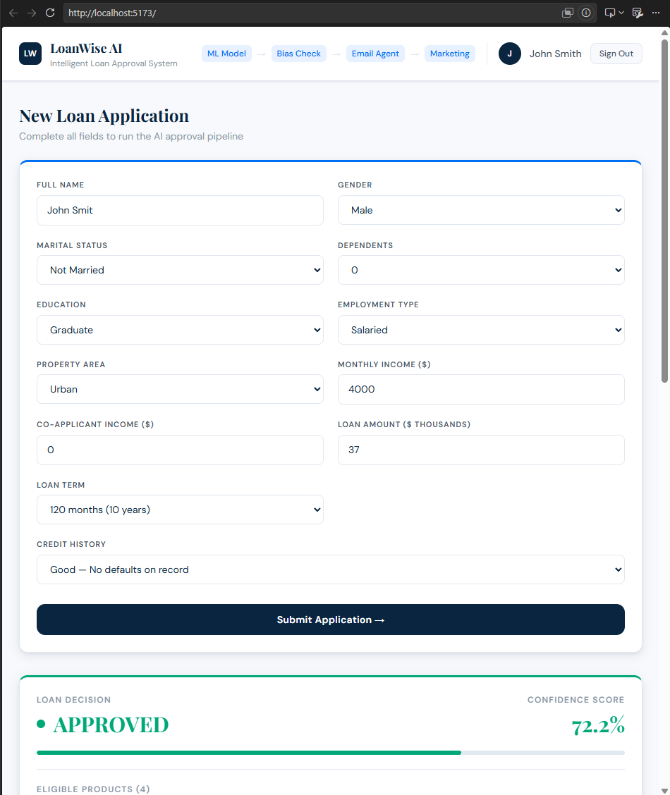
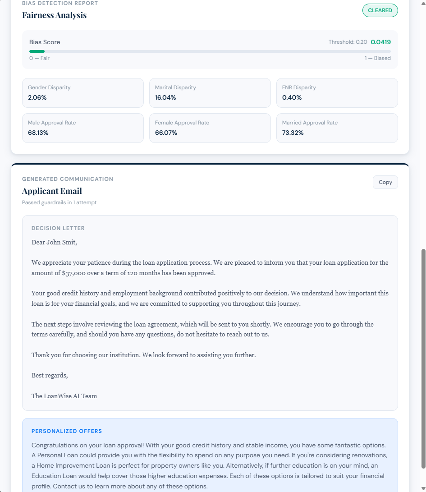
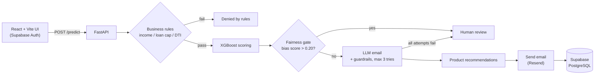

# LoanWise AI

**An end-to-end, AI-assisted loan decisioning platform:** a React frontend, a FastAPI backend serving an XGBoost model, an automated fairness gate, and LLM-generated decision emails with guardrails.


> **Educational project.** LoanWise AI is built on a small public dataset to demonstrate full stack and applied-ML engineering. It is **not** intended for real lending decisions. See [Limitations](#limitations).

## Screenshots

<p align="center">
  
  
</p>

## Overview

A user signs in, submits a loan application, and the backend runs it through a multi-stage pipeline: hard business rules, ML scoring, a fairness check, an LLM-written decision email validated by guardrails, and product recommendations. The result, fairness metrics and email are shown in the UI, emailed to the signed-in user's address, and stored in PostgreSQL.

## Features

- **Full stack web app**: responsive React 19 + Vite + Tailwind CSS UI with email/password authentication (Supabase Auth, JWT-based sessions).
- **Typed REST API**: FastAPI with Pydantic request validation and auto-generated OpenAPI docs at `/docs`.
- **Secured API**: protected endpoints verify the user's Supabase JWT server-side, CORS is restricted to configured origins, and `/predict` is rate-limited per IP.
- **ML scoring**: XGBoost classifier trained on engineered features (log-income, income-to-loan ratio).
- **Business-rule layer** that runs *before* the model, so clearly ineligible applications never reach it.
- **Fairness gate**: computes gender and marital-status approval disparity plus a false-negative-rate gap, combines them into a weighted bias score, and routes the case to human review when the score exceeds a threshold.
- **LLM email generation with guardrails**: GPT-generated decision emails are validated (no invented rates or payment amounts, correct decision, length, required signature) and regenerated up to 3 times before escalating to human review.
- **Product recommendations**: eligibility is decided by deterministic rules; the LLM only writes the recommendation text.
- **Persistence**: every processed application, decision and fairness metric is stored in Supabase (PostgreSQL).
- **Reproducible data science workflow**: six Jupyter notebooks covering exploration, preprocessing, training, and the bias and email/marketing stages.

## Architecture



## Tech stack

| Layer | Technologies |
|---|---|
| Frontend | React 19, Vite, Tailwind CSS 4, Axios, Supabase JS client |
| Backend | Python, FastAPI, Pydantic, Uvicorn, httpx |
| ML / data | XGBoost, scikit-learn, pandas, NumPy, Jupyter |
| AI | OpenAI API (`gpt-4o-mini`) with rule-based guardrails |
| Data & auth | Supabase (PostgreSQL + Auth) |
| Email | Resend |

## Model performance

Trained on the public *Loan Prediction* dataset (614 labelled applications) with a stratified 80/10/10 train/validation/test split (`random_state=42`).

| Split | Rows | Accuracy | Precision | Recall | F1 | ROC-AUC |
|---|---|---|---|---|---|---|
| Validation | 61 | 0.754 | 0.886 | 0.738 | 0.805 | 0.841 |
| **Test** | 62 | **0.790** | **0.857** | **0.837** | **0.847** | **0.824** |

> The dataset is small, so the hold-out sets are small and these figures carry wide uncertainty. They are reported for transparency, not as production-grade benchmarks.

## Fairness audit

The fairness gate combines three disparity measures into one score:

```
bias_score = 0.40 * gender_disparity + 0.40 * FNR_disparity + 0.20 * marital_status_disparity
```

If `bias_score > 0.20`, the application is routed to human review instead of receiving an automated decision.

| Metric (current model, full dataset) | Value |
|---|---|
| Gender approval-rate disparity | 0.021 |
| Marital-status approval-rate disparity | 0.160 |
| False-negative-rate disparity (by gender) | 0.004 |
| **Weighted bias score** | **0.042** (threshold 0.20) |

The audit is a **model-level** check computed over the dataset, so it reflects the behaviour of the deployed model rather than a per-applicant judgement. See [Limitations](#limitations).

## Project structure

```
.
├── src/                     # FastAPI backend
│   ├── main.py              # API routes and pipeline orchestration
│   ├── auth.py              # Supabase JWT verification (FastAPI dependency)
│   ├── bias_agent.py        # Fairness metrics and bias score
│   ├── email_agent.py       # LLM email generation + guardrail validation
│   ├── marketing_agent.py   # Rule-based eligibility + LLM recommendation text
│   ├── email_sender.py      # Resend integration
│   ├── database.py          # Supabase REST persistence
│   └── loan_model.pkl       # Trained XGBoost model
├── frontend/                # React + Vite + Tailwind UI
│   └── src/components/      # Login, LoanForm, DecisionCard, BiasReport, EmailPreview
├── notebooks/               # EDA, preprocessing, training, agent development
├── data/                    # Raw and processed datasets
├── docs/                    # Database schema and screenshots
├── requirements.txt
└── .env.example
```

## Getting started

### Prerequisites

- Python 3.11+
- Node.js 20.19+ (required by Vite 8)
- A [Supabase](https://supabase.com) project, an [OpenAI](https://platform.openai.com) API key, and a [Resend](https://resend.com) API key

### 1. Clone and configure

```bash
git clone https://github.com/SabeehAnsari/loanwise-ai.git
cd loanwise-ai
cp .env.example .env                       # then fill in your keys
cp frontend/.env.example frontend/.env.local
```

### 2. Set up the database

Run [`docs/supabase_schema.sql`](docs/supabase_schema.sql) in the Supabase SQL editor to create the `applications` table and Row Level Security policies.

### 3. Run the backend

```bash
python -m venv .venv
source .venv/bin/activate                  # Windows: .venv\Scripts\activate
pip install -r requirements.txt

cd src
uvicorn main:app --reload --port 8000
```

Interactive API docs: http://127.0.0.1:8000/docs

### 4. Run the frontend

```bash
cd frontend
npm install
npm run dev
```

Open the URL Vite prints (default http://localhost:5173), create an account, and submit an application.

### Environment variables

| Variable | Used by | Purpose |
|---|---|---|
| `OPENAI_API_KEY` | backend | Email and recommendation generation |
| `SUPABASE_URL` | backend | Supabase project URL |
| `SUPABASE_ANON_KEY` | backend | Supabase public (anon) key |
| `RESEND_API_KEY` | backend | Sending decision emails |
| `ALLOWED_ORIGINS` | backend | Comma-separated frontend origin(s) allowed by CORS |
| `VITE_SUPABASE_URL` | frontend | Supabase project URL |
| `VITE_SUPABASE_ANON_KEY` | frontend | Supabase public (anon) key |
| `VITE_API_URL` | frontend | Base URL of the FastAPI backend |

## API reference

| Method | Endpoint | Description |
|---|---|---|
| `GET` | `/` | API info |
| `GET` | `/health` | Health check |
| `POST` | `/predict` | Run the full decision pipeline (auth required) |
| `GET` | `/applications/{user_id}` | List your own past applications (auth required) |

Protected endpoints expect a Supabase access token: `Authorization: Bearer <token>`. The backend verifies it with Supabase Auth and takes the user identity from the token, never from the request body.

**Example: `POST /predict`**

```json
{
  "name": "Jane Doe",
  "gender": 0,
  "married": 1,
  "dependents": 1,
  "education": 1,
  "self_employed": 0,
  "applicant_income": 5000,
  "coapplicant_income": 1500,
  "loan_amount": 120,
  "loan_amount_term": 360,
  "credit_history": 1.0,
  "property_area": 2
}
```

The decision email goes to the authenticated user's own address. `loan_amount` is in thousands and `loan_amount_term` in months. The response contains the `decision`, model `probability`, the `bias_report`, the generated `email`, and `marketing` recommendations. When a case is escalated the `status` is `HUMAN_REVIEW`; when it fails a business rule it is `REJECTED_BY_RULES`.

### Business rules (evaluated before the model)

| Rule | Condition for rejection |
|---|---|
| Minimum income | Combined monthly income < $500 |
| Loan cap | Loan amount > $10,000,000 |
| Positive amount | Loan amount ≤ 0 |
| Debt-to-income | Estimated monthly payment / income > 60% |

## Design decisions

- **Deterministic rules before and around the LLM.** Eligibility and approval are never decided by the language model; it only writes text, and its output is validated before use.
- **Fail safe, not silent.** Any case that trips the fairness gate or fails email guardrails is escalated to human review instead of being auto-decided.
- **Same feature engineering in training and serving.** `preprocess_input` mirrors the notebook pipeline and column order exactly.

## Limitations

This is a learning project, and these limitations are deliberate to state:

- **Not for real lending.** The model is trained on ~600 public records. Gender and marital status are used as model features, which would be inappropriate and, in many jurisdictions, unlawful in production credit decisions. They are included here so the fairness audit has something meaningful to measure.
- **Fairness audit scope.** The score is computed on the dataset, including rows the model was trained on, and is the same for every applicant. It is a model-level audit, not a per-applicant explanation.
- **Small evaluation sets** (about 60 rows each) mean the reported metrics are noisy.
- **Email sending** uses Resend's shared test sender, which only delivers to the account owner's address until a domain is verified.

## Roadmap

- [x] Server-side verification of Supabase JWTs on protected endpoints
- [x] Rate limiting on `/predict` (10 requests/minute per IP), since it calls a paid LLM API
- [ ] Automated tests (pytest for rules and guardrails, Vitest for the UI) and GitHub Actions CI
- [ ] Dockerfile and docker-compose for one-command setup
- [ ] Persist human-review and rule-rejected cases
- [ ] Per-applicant explanations (e.g. SHAP) and a stronger evaluation protocol (cross-validation)
- [ ] Deployment (frontend + API) with a live demo link

## Data

Uses the *Loan Prediction* dataset (Analytics Vidhya / Kaggle). Credit goes to the original dataset authors; check the dataset's terms before redistributing.

## Author

**Sabeeh Ansari**: Computer Science undergraduate, Beijing Institute of Technology
[GitHub](https://github.com/SabeehAnsari) · [Email](mailto:Sabeehansari@outlook.com)
