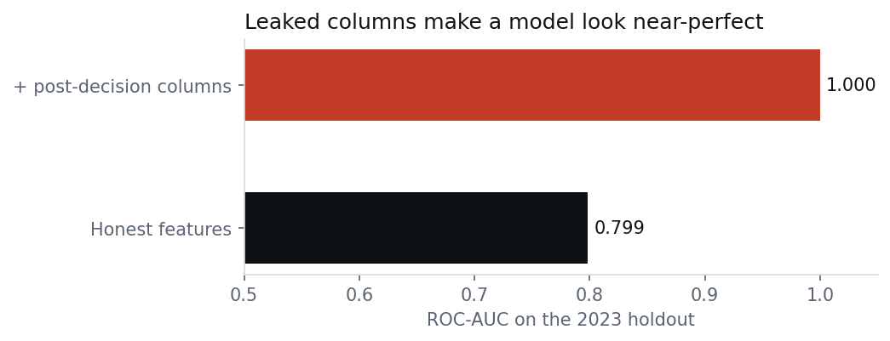
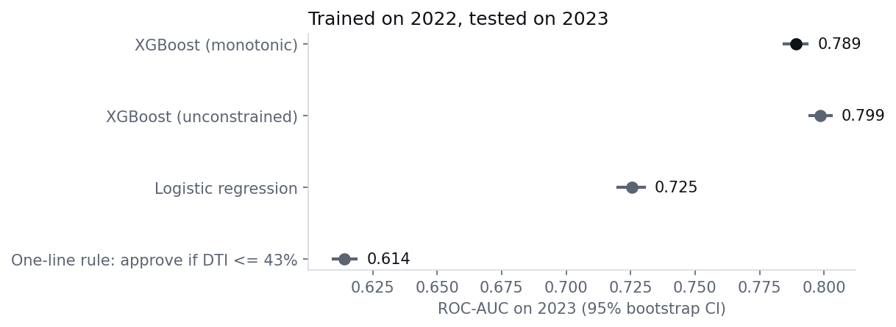
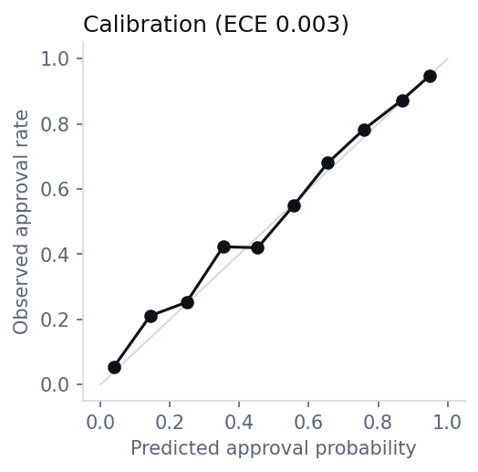
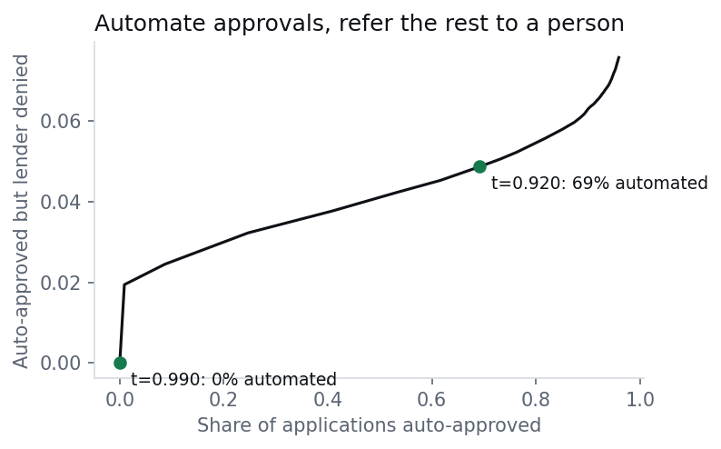
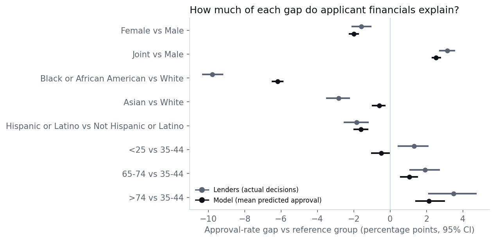
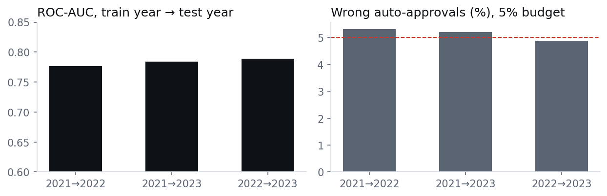
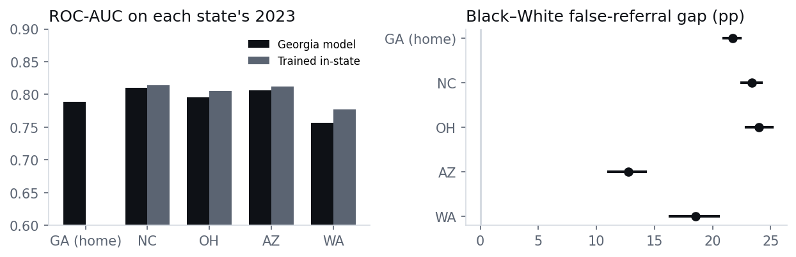
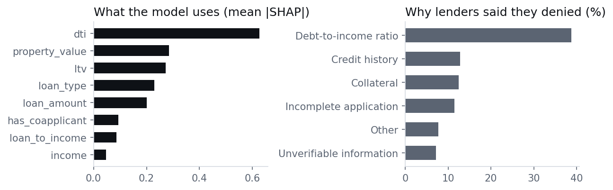

# LoanWise ML v2: results (auto-generated by `python -m ml.run`)

Data: HMDA GA home-purchase decisions. Train 2022 (151,421 applications, 15,650 denials), test 2023 (120,170, 12,890 denials). v1 had 614 rows and 112 women.

## Scope

| Rule | Removed (train) |
|---|---|
| Lender reports DTI and credit data (not partially exempt) | 3,969 |
| First-lien loans only | 3,360 |
| Owner-occupied principal residence | 19,772 |
| Not for a business or commercial purpose | 123 |
| No reverse mortgages or open-end credit lines | 669 |
| Site-built home with 1-4 units | 15,801 |

## Leakage

Honest features: ROC-AUC **0.799**. Adding post-decision columns: **1.000**.

| Column | Post-decision | Missing when denied | Missing when approved | Missingness AUC |
|---|---|---|---|---|
| interest_rate | yes | 100.0% | 0.1% | 1.000 |
| rate_spread | yes | 100.0% | 0.9% | 0.996 |
| origination_charges | yes | 100.0% | 3.6% | 0.982 |
| total_loan_costs | yes | 100.0% | 3.8% | 0.981 |
| discount_points | yes | 100.0% | 42.3% | 0.789 |
| lender_credits | yes | 100.0% | 61.1% | 0.695 |
| denial_reason-2 | yes | 80.0% | 100.0% | 0.600 |
| property_value | no | 4.3% | 0.7% | 0.518 |
| denial_reason-3 | yes | 96.9% | 100.0% | 0.516 |
| income | no | 4.0% | 1.6% | 0.512 |
| log_income | no | 4.0% | 1.6% | 0.512 |
| loan_to_income | no | 4.0% | 1.6% | 0.512 |

### Separation audit (category levels with a single outcome)

| Column | Level | n | Approval rate | Used as a feature |
|---|---|---|---|---|
| preapproval | Requested | 8,613 | 100.0% | no (excluded) |

Effect of the `preapproval` selection leak on the chosen (monotonic) model: without: ROC-AUC 0.789, 0.9% automated at <= 2% wrong approvals; with: ROC-AUC 0.799, 12.2% automated at <= 2% wrong approvals.

## Model comparison (test year)

| Model | ROC-AUC [95% CI] | PR-AUC (denials) | Brier | ECE |
|---|---|---|---|---|
| Majority class (approve everyone) | 0.500 | 0.107 | 0.0958 | 0.0039 |
| One-line rule: approve if DTI <= 43% | 0.614 [0.610, 0.619] | 0.139 | 0.0938 | 0.0021 |
| Logistic regression | 0.725 [0.720, 0.730] | 0.405 | 0.0826 | 0.0249 |
| XGBoost (unconstrained) | 0.799 [0.794, 0.803] | 0.556 | 0.0662 | 0.0039 |
| XGBoost (monotonic) | 0.789 [0.785, 0.793] | 0.537 | 0.0678 | 0.0033 |

## Automation policy

Thresholds are chosen on 2022 out-of-fold predictions for a wrong-auto-approval budget, then applied unchanged to the test year.

| Budget | Threshold | Automated (train, OOF) | Wrong (train, OOF) | Automated (test) | Wrong (test) | Denials referred (test) |
|---|---|---|---|---|---|---|
| 2% | 0.990 | 0.0% | 10.7% | 0.0% | 0.0% | 100.0% |
| 5% | 0.920 | 70.3% | 4.9% | 69.2% | 4.9% | 68.6% |

## Fairness (test year, gaps vs reference group, percentage points [95% CI])

False referral = the lender approved but the model would not auto-approve at threshold 0.920.

| Group | n | Lender approval gap | Model mean-p gap | + geography | Reweighed | False-referral gap (base) |
|---|---|---|---|---|---|---|
| Female vs Male | 32,404 | -1.6 [-2.1, -1.1] | -2.0 [-2.2, -1.7] | -2.2 [-2.4, -1.9] | -1.9 [-2.1, -1.6] | +8.0 [+7.4, +8.8] |
| Joint vs Male | 36,765 | +3.1 [+2.7, +3.5] | +2.5 [+2.3, +2.8] | +2.5 [+2.3, +2.7] | +1.8 [+1.6, +2.0] | -9.6 [-10.2, -9.0] |
| Black or African American vs White | 28,206 | -9.8 [-10.3, -9.2] | -6.2 [-6.5, -5.9] | -7.1 [-7.4, -6.8] | -5.3 [-5.6, -5.0] | +21.7 [+21.0, +22.4] |
| Asian vs White | 9,893 | -2.8 [-3.5, -2.3] | -0.6 [-1.0, -0.3] | -1.1 [-1.5, -0.8] | -0.7 [-1.1, -0.4] | -6.1 [-7.0, -5.3] |
| Hispanic or Latino vs Not Hispanic or Latino | 11,099 | -1.8 [-2.5, -1.2] | -1.6 [-2.0, -1.2] | -1.5 [-1.8, -1.1] | -1.4 [-1.7, -1.0] | +5.5 [+4.5, +6.4] |
| <25 vs 35-44 | 6,665 | +1.3 [+0.5, +2.1] | -0.5 [-1.0, -0.1] | -0.4 [-0.9, +0.0] | -0.6 [-1.1, -0.2] | +7.2 [+6.0, +8.6] |
| 65-74 vs 35-44 | 6,425 | +1.9 [+1.1, +2.7] | +1.1 [+0.6, +1.5] | +1.0 [+0.6, +1.4] | +0.6 [+0.1, +1.0] | -5.8 [-6.9, -4.7] |
| >74 vs 35-44 | 1,875 | +3.5 [+2.1, +4.7] | +2.1 [+1.4, +3.0] | +2.2 [+1.5, +3.0] | +1.6 [+0.9, +2.5] | -7.8 [-9.5, -5.8] |

| Variant | ROC-AUC | Brier | ECE |
|---|---|---|---|
| base | 0.789 | 0.0678 | 0.0033 |
| geography | 0.796 | 0.0679 | 0.0025 |
| reweighed | 0.786 | 0.0679 | 0.0026 |

## Robustness: drift over time (Georgia)

Each model keeps the threshold chosen on its own training year (5% budget).

| Model | Test year | Actual approval | Mean predicted | ROC-AUC | ECE | Automated | Wrong auto-approvals |
|---|---|---|---|---|---|---|---|
| trained on 2021 | 2022 | 89.7% | 89.9% | 0.777 | 0.008 | 77.5% | 5.3% |
| trained on 2021 | 2023 | 89.3% | 89.0% | 0.784 | 0.011 | 74.7% | 5.2% |
| trained on 2022 | 2023 | 89.3% | 89.1% | 0.789 | 0.003 | 69.2% | 4.9% |

| Year | Applications | Approval rate | Median DTI | Median LTV | Median loan | Median income |
|---|---|---|---|---|---|---|
| 2021 | 185,006 | 90.8% | 38% | 95.0% | $275,000 | $81,000 |
| 2022 | 151,421 | 89.7% | 40% | 95.0% | $305,000 | $93,000 |
| 2023 | 120,170 | 89.3% | 42% | 95.0% | $315,000 | $102,000 |

## Robustness: unseen states (2023, Georgia model and threshold)

| State | Applications | Actual approval | Mean predicted | ROC-AUC (GA model) | ROC-AUC (in-state, 20% holdout) | GA model on same holdout | Automated | Wrong auto-approvals |
|---|---|---|---|---|---|---|---|---|
| NC | 126,814 | 92.0% | 89.3% | 0.807 | 0.814 | 0.810 | 70.3% | 3.3% |
| OH | 114,248 | 92.3% | 89.1% | 0.791 | 0.805 | 0.796 | 62.0% | 3.0% |
| AZ | 84,008 | 91.1% | 89.7% | 0.800 | 0.813 | 0.807 | 73.1% | 3.8% |
| WA | 71,216 | 93.2% | 90.1% | 0.770 | 0.777 | 0.757 | 74.2% | 3.3% |

| State | Group | n | Lender gap | Model mean gap | False-referral gap |
|---|---|---|---|---|---|
| NC | Black or African American vs White | 16,448 | -8.7 [-9.3, -8.2] | -6.5 [-6.8, -6.1] | +23.4 [+22.5, +24.2] |
| NC | Hispanic or Latino vs Not Hispanic or Latino | 10,796 | -2.8 [-3.4, -2.2] | -2.0 [-2.3, -1.6] | +8.6 [+7.6, +9.6] |
| OH | Black or African American vs White | 9,113 | -8.6 [-9.5, -7.9] | -6.0 [-6.4, -5.6] | +24.0 [+22.9, +25.2] |
| OH | Hispanic or Latino vs Not Hispanic or Latino | 4,321 | -4.8 [-5.8, -3.9] | -3.3 [-3.8, -2.9] | +15.6 [+14.1, +17.0] |
| AZ | Black or African American vs White | 3,842 | -8.7 [-9.9, -7.5] | -5.2 [-5.8, -4.4] | +12.8 [+11.1, +14.3] |
| AZ | Hispanic or Latino vs Not Hispanic or Latino | 18,029 | -4.1 [-4.5, -3.5] | -3.6 [-3.9, -3.3] | +18.6 [+17.8, +19.4] |
| WA | Black or African American vs White | 2,425 | -6.0 [-7.2, -4.7] | -5.3 [-6.2, -4.5] | +18.5 [+16.4, +20.5] |
| WA | Hispanic or Latino vs Not Hispanic or Latino | 5,446 | -3.9 [-4.7, -3.2] | -3.0 [-3.6, -2.5] | +10.6 [+9.3, +12.0] |

## Explanations

_Runtime 149.5 s._
